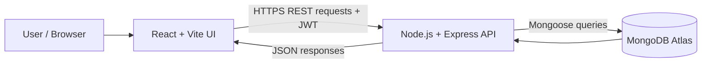

# Application architecture

## Data collections
- **users**: name, email, hashed password, createdAt, updatedAt
- **tasks**: title, description, dueDate, priority, status, user reference, createdAt, updatedAt

## Authentication flow
1. User submits registration or login details.
2. Express validates input; bcrypt hashes or checks the password.
3. API returns a signed JWT and safe user profile.
4. React sends the JWT as a Bearer token for protected API calls.
5. Middleware verifies the token and attaches the authenticated user ID.
6. Task queries always include that user ID so users can access only their own tasks.
